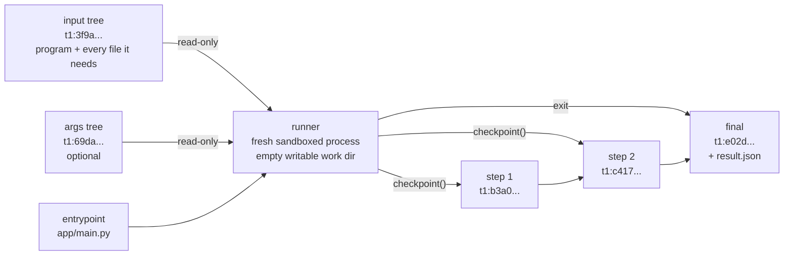
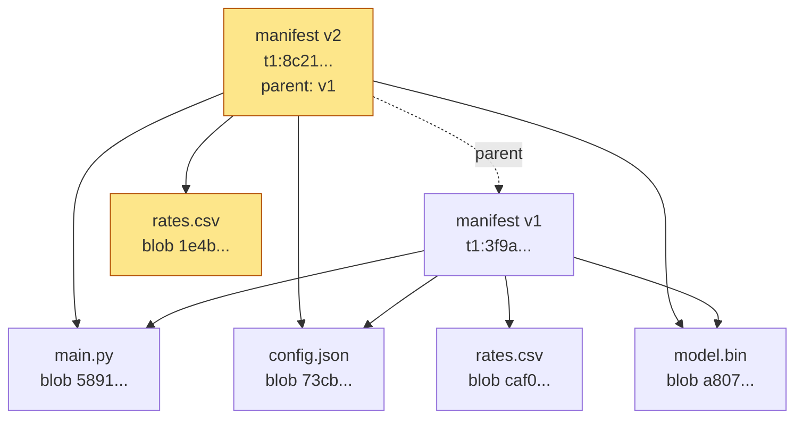
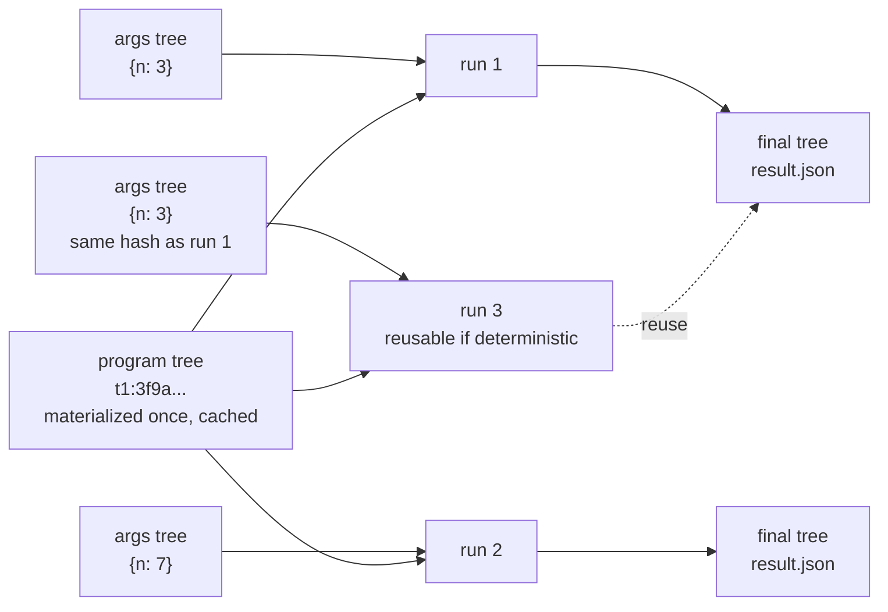
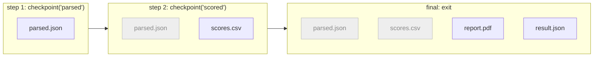
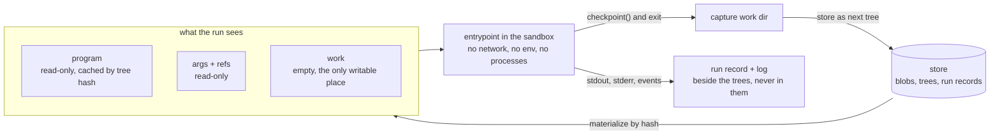
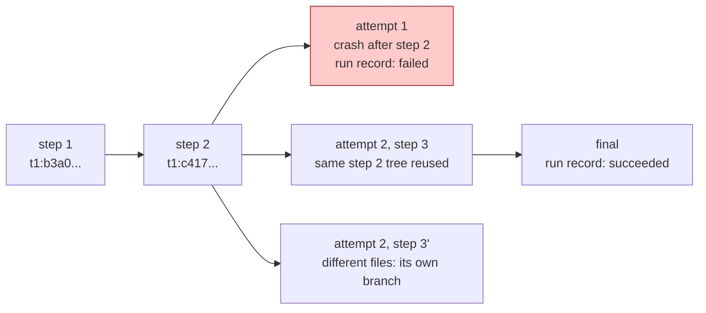

A pattern for running untrusted code

# Hash-Pinned Code Execution

A run is files in, files out. It starts one file in a tree named by its hash and leaves its results as a sequence of trees.

The model has three parts: an **input tree** (the program and every file it needs), an **entrypoint** (the file that runs), and **output trees** (the files the run produces, as a sequence of snapshots). Arguments and return values are allowed, but they are files too. Beside the trees, the runner keeps a **run record** and a **live log** of what it observed. It is aimed at code that may be wrong or hostile, such as code a model wrote, where you need to know exactly what ran, what it saw, and what it produced.



The whole model, without the run record and live log, which sit beside it and are covered near the end.

Part 1

## The input tree: a program and its files

- **The tree holds everything the program needs,** not just code: config, prompts, templates, lookup tables, reference data, images, model weights.
- **Each file is stored under the hash of its bytes.** Identical files are stored once, and an existing stored file can be added to a tree by reference without copying it.
- **A manifest lists** `path → file hash`. The hash of that sorted list is the **tree hash**: a name for one exact set of files.
- **Any change is a new version.** Editing a config value or a data table produces a new tree hash just like editing code. The new manifest points at the one it came from, and an old hash always means the same files.
- **Whoever relies on a tree hash recomputes it** from the files. The manifest is the writer's claim, and a test result attached to a hash is only worth something if the tester verified it.
- **A large dependency set** (a vendored `node_modules`, for example) goes beside the manifest as one hashed file, so the manifest stays small and the set is shared across trees.

This is git's object model (blob, tree, commit, ref) used as primary storage, with git as an export format.



Changing one row in `rates.csv` stores one new file and one new manifest. The other three files are shared by every version.

Part 2

## The entrypoint: what runs, with what arguments

- **The entrypoint is a path inside the input tree,** optionally with a function name when one file exports several. It is kept out of the tree hash: the hash says which files exist; the entrypoint says which one starts.
- **A language is supported by a small shim** that imports the file and calls the function, so the runner never needs to know which language it is running.
- **A run is described by a run spec:** program tree, optional args tree, entrypoint, optional function, and sandbox profile. Every output tree records it.

### Arguments and return values are files

Four calling styles are allowed. Each one converts to files, so identity, caching and lineage work the same whichever is used.

| Style | Arguments | Result |
| --- | --- | --- |
| A. Pure files | Part of the input tree | Files in output trees |
| B. Args tree | A second small tree, mounted read-only at a known path | Files |
| C. Serialized call | `main(args)`: an args tree holding one `args.json` | Return value, stored as `result.json` in the final tree |
| D. Named endpoint | Like C, with a function name in the spec | Like C |

- **Splitting program from arguments keeps the program's hash stable.** Many calls share one program tree, which stays cached, and each call adds one tiny args tree.
- **Serialized arguments are canonical.** Keys sorted, one encoding (for example RFC 8785 JSON), so equal arguments always hash the same.
- **Large data is passed by hash, and the runner resolves it.** An argument may name a stored tree or file. The runner materializes it before the run and records it, so everything the code saw is in the record and the code never needs a network.
- **A return value is for small, structured answers** something downstream branches on: a verdict, a score, a choice. Produced material stays files. Only the final tree carries `result.json`.
- **A returned "no" is not a failure.** `{"ok": false}` is a successful run with a negative answer; a crash is a failed run. The two are recorded in different places, so a retry never re-asks a question that was already answered.
- **Reuse is opt-in.** A run whose spec was already run can be answered from the stored trees instead of running again, but only when the spec says the code is deterministic.



Calling the same program with different arguments changes only the args tree. The program tree, and its cached copy on disk, is shared by every call.

Part 3

## Output trees: what a run produced, step by step

- **A run's working directory starts empty and is the only writable place it has.** The code just writes `parsed.json` or `report.pdf`, in any language.
- **A run produces a sequence of trees, not one.** When the files on disk are a meaningful intermediate result, the code calls `checkpoint()`, provided by the shim. The runner captures the working directory as the next tree in the run's sequence, and the call returns once it is stored. When the run exits, the directory is captured one last time as the final tree, with `result.json` added if the function returned a value.
- **Each tree in the sequence is complete, not a diff.** It is a full manifest of the directory at that moment, based on the previous step. Files that did not change between steps are the same stored files, so a checkpoint costs only what changed.
- **A step that changed nothing adds nothing.** A checkpoint over an unchanged directory returns the previous tree, and a run that writes nothing produces no trees.
- **Every step is a tree like any other.** It has its own hash, so it can be inspected, compared with the step before, or become the input of another run while this one is still going.
- **Output trees are never the input tree.** The input tree is shared by every run and named by its hash, so writing into it would race other runs and change what the hash refers to. A run cannot modify its own program.
- **Each tree records where it came from:** the run spec and the step before it. Together these answer "what produced this, and in which order".
- **Only what the code wrote goes in a tree.** stdout, stderr and the exit status belong to the run record below. A log that is itself a result is written as a file, such as `build.log`.



Dark file names are new or changed in that step; grey ones are carried over and stored once. If the run crashes after step 2, steps 1 and 2 are still there to inspect.

Running it

## A generic runner and a sandbox contract

- **One runner process serves every run spec.** For each run it materializes the file system, starts the entrypoint in the sandbox the spec names, and captures the working directory at each checkpoint and at exit.


- **Materializing builds the file system a run sees,** from stored files and nothing else:
  - the program tree, written out as real files at a read-only path (cached by tree hash, so a second run of the same tree writes nothing);
  - the args tree, if any, read-only at a known path, plus any stored trees or files the arguments name by hash;
  - an empty, writable working directory.

  Every file a run can read comes from a hash recorded before it starts. Capturing a checkpoint is the reverse step: files on disk become a stored tree.
- **Each run is a fresh process.** Cached files are safe to share because the hash identifies them. A reused process could carry state from the previous run.

The sandbox implementation is out of scope. What the model needs from it is a contract:

- **No other way out.** The run reaches only its materialized trees, its working directory, the runner channel, and stdout and stderr. No network, no environment variables, no new processes.
- **Bounded.** Time and output size at minimum. Memory and CPU are either declared or stated as unbounded, never left implied.
- **Declared.** A profile that grants anything extra, such as network access, says so, and the profile is part of the run spec every output tree records.
- **Checkable.** A runner can test a backend against its declaration, for example with an escape attempt that must fail.

Interface

## The runner channel

Today the code has one call to the runner, `checkpoint()`. More will follow, and there will be several language shims and several sandbox backends, so the interface is specified in three layers rather than agreed privately between each pair.

| Layer | What it is | Specified |
| --- | --- | --- |
| Language API | The calls as each language exposes them, such as `checkpoint()` | Per shim; names and meanings follow the protocol |
| Protocol | Messages, framing, request and response, errors, versioning | Normative, with a conformance suite |
| Transport binding | How frames travel in a given sandbox | One default for process sandboxes; others conform to the protocol |

The protocol is separate from the transport because backends offer different channels: a process can inherit extra file descriptors or named pipes, a VM has vsock, WebAssembly has host imports, a browser worker has `postMessage`. The same messages work over all of them.

A shim and a runner that both pass the protocol's conformance suite work together over any binding, whatever language the shim is for.

### The protocol

- **A dedicated channel, never stdout.** Frames that share stdout with the program's own printing get corrupted by any output without a trailing newline. On its own channel, the framing can be trivial.
- **Newline-delimited JSON,** one frame per line, each with a size cap.
- **Request and response with an id.** Calls look synchronous to the code, but ids allow concurrent calls later without a protocol change.
- **Handshake first.** The runner sends the protocol version and the calls it offers. The shim exposes only those; any other call fails with an error naming it. Different sandbox profiles can offer different calls, and the offered set goes in the run record.
- **Structured errors,** with a code and a message. The runner also writes every refused or failed call to the live log, since an error visible only inside the sandbox is invisible to whoever is debugging.
- **Additive evolution.** New calls and new optional fields only. A breaking change is a new protocol version, chosen in the handshake.
- **The call list is published as data,** so authors, models included, can look up exact call shapes instead of guessing.
- **The channel is untrusted.** The runner validates every frame, caps size and rate, and applies every rule on its own side. A malformed or forged frame fails that call or ends the run; it never gains anything.

```
runner → code  {"hello": {"protocol": 1, "calls": ["checkpoint", "progress"]}}
code → runner  {"id": 1, "call": "checkpoint", "args": {"label": "parsed"}}
runner → code  {"id": 1, "result": {"step": 1, "tree": "b3a0…"}}
code → runner  {"id": 2, "call": "materialize", "args": {"tree": "77be…"}}
runner → code  {"id": 2, "error": {"code": "not_offered", "message": "materialize is not offered in profile no-net"}}
```

### What a call may do

Every call is classified by what it brings into the run. This rule is what keeps "everything the run saw is recorded" true as calls are added.

| Kind | Examples | Rule |
| --- | --- | --- |
| Control | `checkpoint(label?)`, `deadline()`, `cancelled()` | Brings no data in. Free to add. |
| Observation | `progress(fraction, message)`, `event(name, fields)` | Flows out to the live log only, never into a tree. |
| Input | `materialize(hash) → path` | Brings data in, so the runner records it in the run record by hash. Data arrives as a path to files, never as bytes in a frame. |

- **Anything that returns data is an input.** An input call is allowed only if the runner can name exactly what it handed over.
- **Bytes never travel in frames.** They go in and out as files, so frames stay small and the size cap means something.
- **The runner may notify the code** on the same channel, for example "cancel requested" or "deadline approaching". The code may ignore these; the sandbox's time limit is the real enforcement.

### The default binding for process sandboxes

- **Two pipes,** one each way, handed to the child as inherited file descriptors 3 and 4, or as named pipes in a control directory where the process API cannot pass extra descriptors.
- **The runner opens both ends of both pipes before starting the child,** so neither side ever blocks waiting for the other to open.
- **The read loop ends on process exit plus a short quiet window,** since the runner holding both ends means end-of-file never arrives.
- **A profile with no channel** makes every call fail with "not available in this profile", never hang or silently do nothing.

**The conformance suite** checks at least that frames survive heavy stdout output, an unoffered call fails cleanly, an input call appears in the run record, and a forged frame gains nothing.

Input and output

## Files in, files out

| Direction | Channel | Written by |
| --- | --- | --- |
| In: program | The program tree, materialized read-only |  |
| In: arguments | The args tree (or `args.json`), materialized read-only |  |
| Out: steps | `checkpoint()`: the working directory becomes the next tree | The code |
| Out: final | The working directory at exit, plus `result.json` | The code |
| Calls | Control, observation and input calls over the runner channel | The code asks, the runner answers |
| Run record | Exit status, timing, environment, links to trees and log | The runner |
| Live log | stdout, stderr and runner events, streamed while the run is going | The runner |

The code never sends data anywhere. It writes files and says when they are worth keeping; the runner stores them, and separately records what it watched the process do.

Observation

## Run record and live log

Trees hold what the code produced. What the runner observed about the process goes beside them, never into a tree or its hash. Logs carry timestamps and timings, so putting them in a tree would make identical results hash differently, turn diagnostics into inputs for the next run, and make them impossible to delete without breaking the tree.

### The run record

One per attempt, written by the runner:

- the run spec and the attempt number;
- exit status, or timeout or killed, with duration and resource use;
- the environment: interpreter version and sandbox backend, which the tree hash does not cover;
- the protocol version and calls offered, and every input call with the hash it handed over;
- the output trees it produced or reused;
- a link to the stored log, with the log position at each checkpoint, so you can see what was printed up to step N.

The exit status in the record is the run's verdict. A final tree exists either way; the record says whether it came from a clean exit. A retry is a new record pointing at reused steps. A reused result is a record that says "answered from the stored trees of attempt X", with no log of its own.

### The live log

The runner publishes one ordered stream per attempt: the process's stdout and stderr, interleaved with the runner's own events.

- **One sequence number across all sources.** A viewer that disconnects resumes from its last number; one that joins late replays from the start and then follows live.
- **Stored while it streams.** The runner appends the stream to storage in chunks as it forwards it, so the live view and the stored log are the same data. At exit the chunks are sealed and the run record links them.
- **The run never waits for a viewer.** The runner drains the process's output at full speed. A slow viewer falls behind and catches up from storage; it never slows the run.
- **The shim turns off output buffering.** Most runtimes hold output when it is not going to a terminal, which would make a live log arrive all at once at the end.
- **Order between stdout and stderr is approximate.** They are separate pipes, ordered by when the runner read each line.
- **The cap applies to storage.** A live viewer can see everything; the stored copy keeps the start and the end within a size cap, and has its own, shorter retention than trees.
- **The text is untrusted.** The source of each line is set by the runner, never parsed from the text, so code cannot print a fake runner event. Viewers strip terminal control sequences before display.

Viewers watch the log as it is written. Checkpoint events in the log point at the trees they produced, and the run record ties the attempt together once it ends. Nothing in the log or the record is part of a tree hash.

**Failures are reported precisely.**

- The exit status counts: a run that wrote everything and then crashed is a failure.
- If a checkpoint cannot be saved, the call fails inside the run, which can stop or retry. If the final tree cannot be saved, the run is retried rather than reported as done.
- Steps saved before a crash stay, and the stored log shows what was printed up to the crash.
- A retried run that reaches step 2 again with the same files reuses the stored step 2; with different files it starts its own branch from the last step they share, so both attempts stay visible.



Summary

A program tree holds a program and every file it needs, named by one hash. A run spec picks a file and function in it, an optional args tree, and a sandbox. The code reads files, writes files, calls `checkpoint()` when they are worth keeping, and may return a small value. It talks to the runner only over a specified channel, where any call that brings data in is recorded. What it leaves is a sequence of output trees, the last one holding `result.json`. What the runner saw it do, exit status and a live, stored log, goes in a run record beside the trees, never inside them.

Limits

## What it does not cover

- **The environment is recorded, not hashed.** The run record names the interpreter version and sandbox backend, but two runs with the same spec on different interpreters share a spec identity.
- **Determinism.** The same spec can produce different trees if the code reads the clock or a random source. The model records what happened; it does not make it repeatable, which is why reuse is opt-in.
- **Start-up time.** A fresh process per run costs a few tens of milliseconds. Caching trees by hash removes the cost of writing files, not of starting the process.
- **Outside effects.** If a sandbox profile allows network access, whatever the code does over the network is not captured in any tree and may happen again on a retry.
- **Long-lived services.** A process that serves many requests carries state between them, so no single call is explained by its recorded inputs. That is a different model and is not covered here.